# Tanda Doloreña

Sistema de ahorro rotativo vecinal (tanda) hecho en Flutter y construido 100% con TDD.

Proyecto complementario de práctica de Desarrollo Móvil Integral.

**Autor:** Aguilar Ortiz Gael Alejandro, GTID235, UTNG

## ¿Qué es una tanda?

Un grupo de vecinos aporta la misma cantidad en cada ronda y, en cada ronda, una sola persona recibe el total reunido, siguiendo un orden de turnos acordado.

## Reglas de negocio protegidas con pruebas

- Cada participante aporta como máximo una vez por ronda.
- Solo puede aportar quien pertenece a la tanda.
- La ronda solo se cierra cuando todos ya aportaron.
- Al cerrar una ronda, el turno se entrega según el orden acordado y avanza al siguiente.
- Cuando todos ya recibieron su turno, la tanda termina y no acepta más aportaciones.

## Estructura del proyecto

    lib/
      modelos/
      logica/
      presentation/
      main.dart
    test/
      servicio_tanda_test.dart

## Cómo ejecutar

    flutter pub get
    flutter test
    flutter run

## Evidencias del proceso TDD

### Ronda 1 - ROJO: la prueba falla

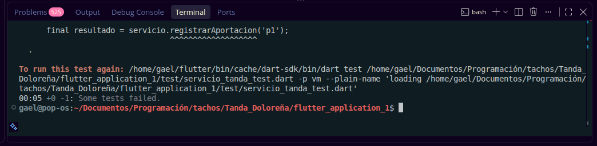

### Ronda 1 - VERDE: la prueba pasa

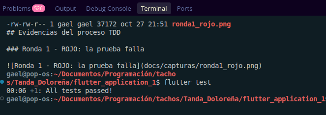

### Ronda 2 - ROJO: rechazar aportación repetida

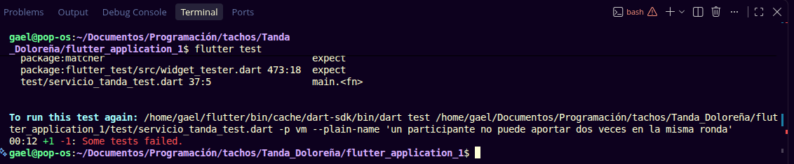

### Ronda 2 - VERDE: las 2 pruebas pasan

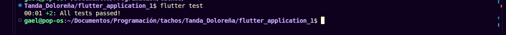

### Ronda 3 - ROJO: rechazar a quien no es participante

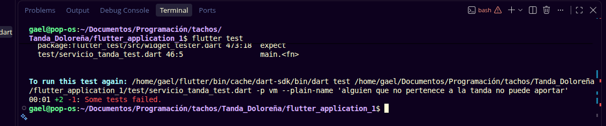

### Ronda 3 - VERDE: las 3 pruebas pasan

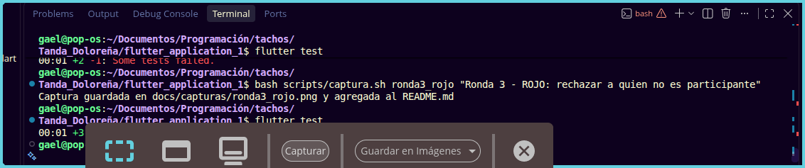

### Ronda 4 - ROJO: puedeCerrarRonda no existe

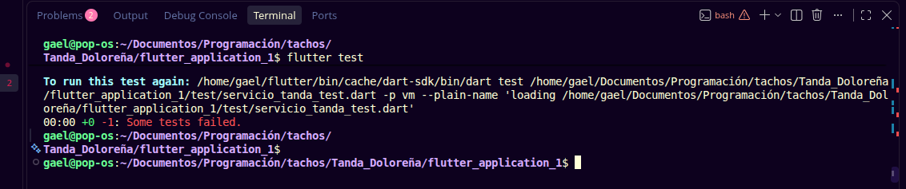

### Ronda 4 - VERDE: las 5 pruebas pasan

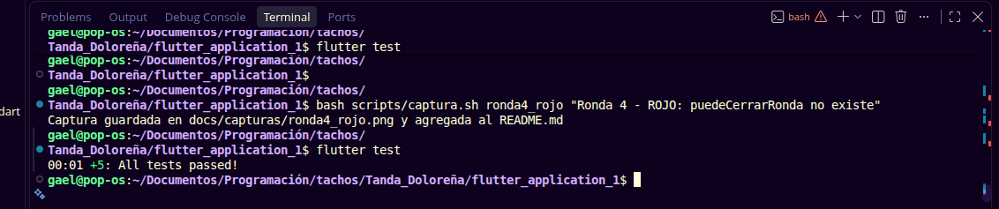

### Ronda 5 - ROJO: cerrarRondaYAvanzar no existe

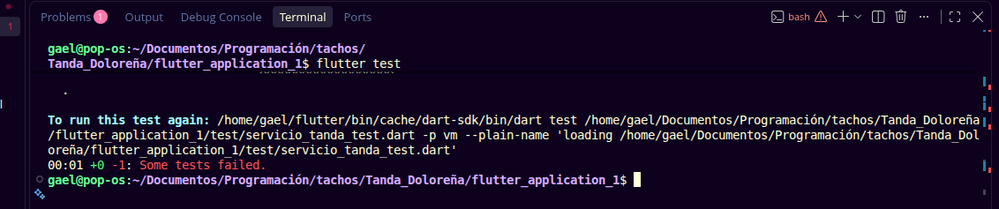

### Ronda 5 - VERDE: las 6 pruebas pasan

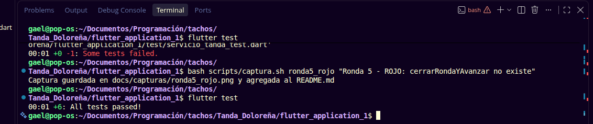

### Ronda 6 - VERDE: pasa sin código nuevo, la regla ya estaba protegida

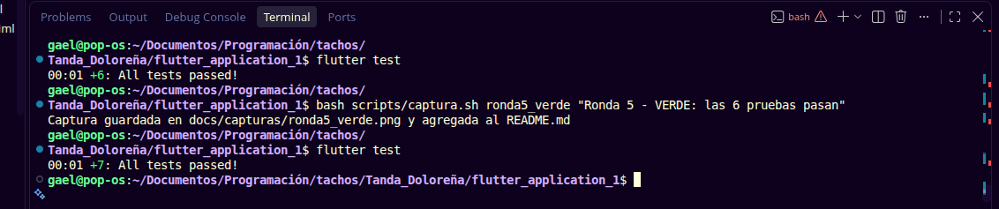

### Ronda 7 - ROJO: haTerminado no existe

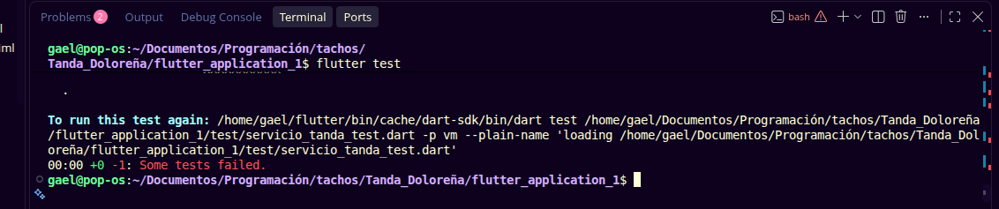

### Ronda 7 - VERDE: las 10 pruebas pasan

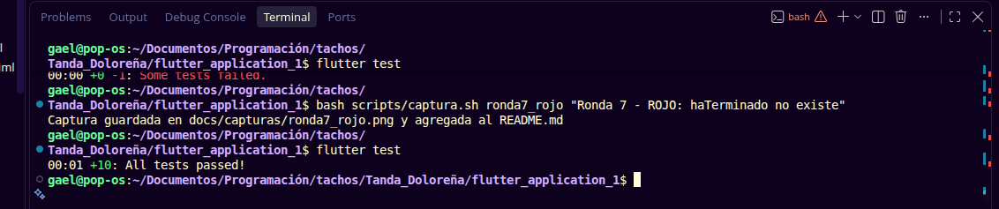

### Ronda 8 - REFACTOR: las 10 pruebas siguen en verde

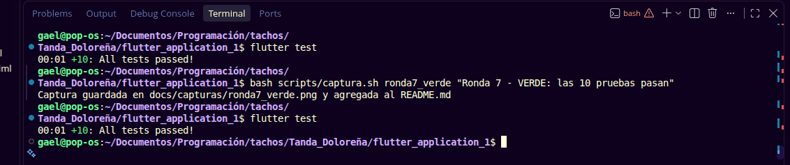

### Prueba de integración: las 11 pruebas pasan

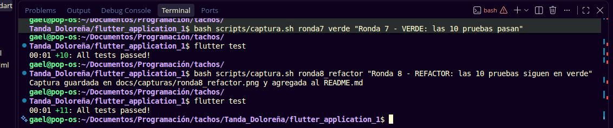
